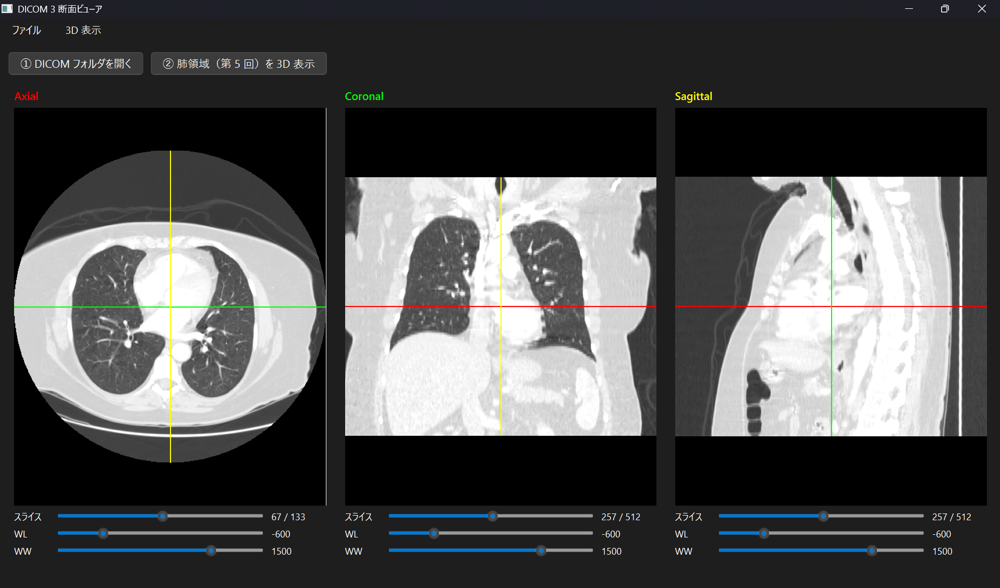
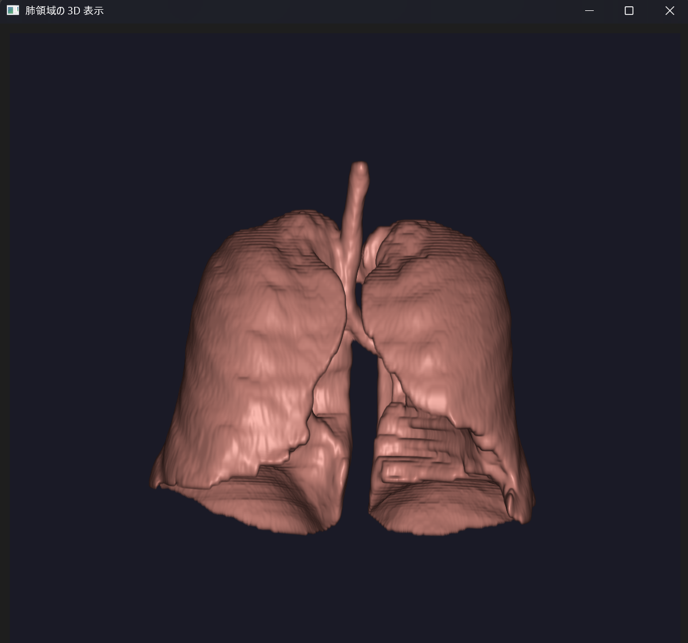

# DICOM 3 断面ビューア

知能情報実験実習２ 医用画像処理実験 最終課題

CT の DICOM を読み込み，Axial・Coronal・Sagittal の 3 断面を表示します．第 5 回で抽出した肺領域を 3D 表示（ボリュームレンダリング）することもできます（観点 7）．




## 課題との対応

| 観点 | 実装 |
|---|---|
| 1 | PySide6 と matplotlib で Viewer を作成 |
| 2 | 「ファイル」→「DICOM フォルダを開く...」（画面上部の「① DICOM フォルダを開く」ボタンも同じ） |
| 3 | Axial・Coronal・Sagittal を左から並べて表示 |
| 4 | 他の 2 断面の位置を線で表示（赤 = Axial，緑 = Coronal，黄 = Sagittal） |
| 5 | 各断面の下のスライダーでスライス位置・WL・WW を変更 |
| 6 | スライス位置のスライダーを動かすと，他の断面の線も動く |
| 7 | 画面上部の「② 肺領域（第 5 回）を 3D 表示」ボタン（またはメニューの「3D 表示」）で，第 5 回の肺領域を VTK でボリュームレンダリング |

## 動作環境

- Python 3.11（Windows 11，Python 3.11.9 で確認）
- 使うパッケージとバージョンは `requirements.txt` に記載

## インストール

展開したフォルダ（`main.py` があるフォルダ）で実行します．

Windows（コマンドプロンプト）

```bat
py -3.11 -m venv .venv
.venv\Scripts\activate
pip install -r requirements.txt
```

macOS / Linux

```bash
python3.11 -m venv .venv
source .venv/bin/activate
pip install -r requirements.txt
```

## 起動

仮想環境を有効にした状態で実行します．

```bash
python main.py
```

## 使用データ

| データ | 場所 |
|---|---|
| CT（DICOM） | 授業で配布された `LIDC-IDRI-0265_CT`（133 枚）を使います．容量が大きいため，このフォルダには入れていません． |
| 第 5 回で抽出した肺領域 | `data/lung_mask_session5.tif` に同梱しています． |

## 操作方法

1. **「① DICOM フォルダを開く」**（または「ファイル」→「DICOM フォルダを開く...」）で，`LIDC-IDRI-0265_CT` フォルダを選びます．
2. 各断面の下のスライダーで，スライス位置・WL・WW を変えます．
3. **「② 肺領域（第 5 回）を 3D 表示」**（または「3D 表示」メニュー）を押すと，`data/lung_mask_session5.tif` を読み込み，別ウィンドウに肺が 3D 表示されます．
   - 左ドラッグ: 回転，右ドラッグ・ホイール: 拡大縮小
   - 肺とつながっていない小さい領域（寝台のすき間・腸のガスなど）は除いて表示します．

## ファイル構成

```
main.py                     アプリ本体
requirements.txt            使用パッケージ
data/lung_mask_session5.tif 第 5 回で抽出した肺領域（肺 = 255，背景 = 0，133 枚）
```
